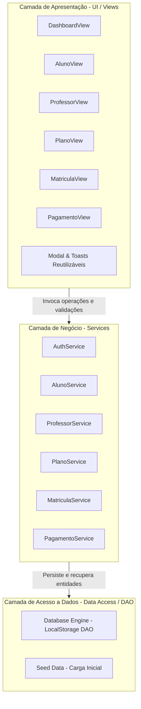
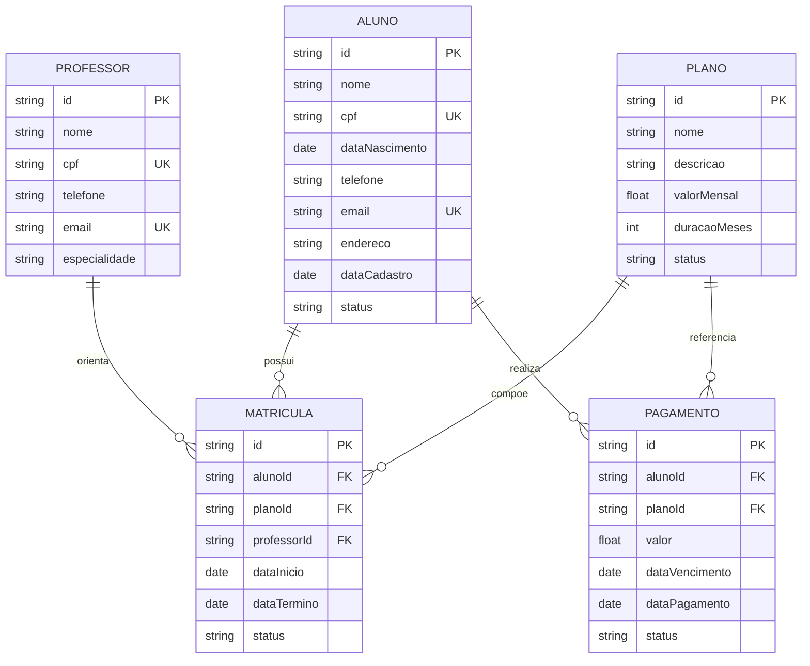

# Documento de Arquitetura e Engenharia de Software

**Projeto:** FitZone Pro - Sistema de Gerenciamento de Academia  
**Disciplina:** Engenharia de Software  

---

## 1. Especificação de Requisitos

### 1.1 Requisitos Funcionais (RF)

| ID | Descrição | Módulo |
|---|---|---|
| **RF01** | Permitir autenticação de usuários administradores com e-mail e senha. | Autenticação |
| **RF02** | Apresentar um painel de indicadores (Dashboard) com contagem de alunos (total e ativos), professores, planos e pagamentos pendentes. | Dashboard |
| **RF03** | Efetuar as operações de CRUD (Criar, Listar, Editar e Excluir) para alunos, com busca textual por nome, CPF e e-mail. | Alunos |
| **RF04** | Permitir alternar o status do aluno entre ativo e inativo. | Alunos |
| **RF05** | Efetuar as operações de CRUD para professores, associando especialidades técnicas. | Professores |
| **RF06** | Efetuar as operações de CRUD para planos de adesão, com valor e duração estipulados. | Planos |
| **RF07** | Efetuar a matrícula de um aluno, relacionando aluno, plano contratado, professor responsável e período de vigência. | Matrículas |
| **RF08** | Registrar e gerenciar faturas de pagamento, permitindo consulta de status (pago, pendente, atrasado) e ação rápida de baixa de recebimento. | Pagamentos |

---

### 1.2 Requisitos Não Funcionais (RNF)

| ID | Categoria | Descrição |
|---|---|---|
| **RNF01** | **Usabilidade** | Interface gráfica moderna com alto contraste, fontes legíveis, design responsivo e feedback visual via mensagens toast. |
| **RNF02** | **Portabilidade** | Aplicação executável em qualquer navegador moderno sem necessidade de instalação de dependências ou servidores complexos. |
| **RNF03** | **Manutenibilidade** | Código modular com divisão explícita em camadas: Apresentação, Serviços/Regras de Negócio e Acesso a Dados. |
| **RNF04** | **Confiabilidade & Persistência** | Armazenamento de dados local com tratamento de integridade referencial antes de operações de exclusão. |

---

## 2. Regras de Negócio (RN)

- **RN01 (Unicidade de CPF):** Não é permitido cadastrar dois alunos ou dois professores com o mesmo número de CPF.
- **RN02 (Unicidade de E-mail):** Não é permitido cadastrar dois alunos ou dois professores com o mesmo endereço de e-mail.
- **RN03 (Matrícula Única Ativa):** Um aluno pode possuir apenas **uma** matrícula com status "ativa" simultaneamente. Para realizar nova matrícula, a anterior deve estar cancelada ou concluída.
- **RN04 (Integridade do Pagamento):** Não é permitido gerar registro de pagamento sem a seleção prévia de um aluno cadastrado no sistema.
- **RN05 (Cálculo de Atraso):** Se um pagamento estiver com status "pendente" e sua data de vencimento for anterior à data atual do sistema, o status passa dinamicamente a ser considerado "atrasado".
- **RN06 (Proteção Contra Exclusão Órfã):** Não é permitido excluir alunos ou professores que possuam vínculos com matrículas ativas.

---

## 3. Padrão Arquitetural em Camadas (3-Tier)

O sistema adota o padrão em camadas para garantir baixo acoplamento e alta coesão:

---

## 4. Diagrama de Entidade e Relacionamento (Conceitual)

---

## 5. Padrões de Projeto (Design Patterns) Utilizados

1. **Module Pattern (Módulo Revelador)**: Utilizado em todos os arquivos JavaScript para encapsular funções privadas e expor apenas métodos públicos bem definidos.
2. **Repository / Data Access Object (DAO)**: A camada `db.js` centraliza o acesso ao armazenamento, isolando a tecnologia de persistência das regras de negócio.
3. **Service Layer**: Toda regra de validação (ex: CPF único, cálculo de matrícula ativa) é tratada em serviços dedicados, evitando acoplamento direto com a interface do usuário.
4. **Observer / Event-Driven UI**: As Views escutam eventos de formulário, executam serviços e notificam a interface com atualizações imediatas e mensagens toast informativas.
